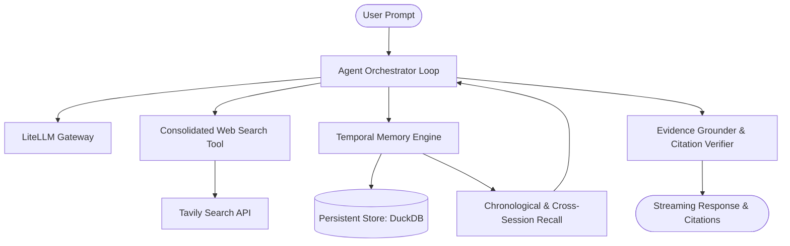

# Minimi

Minimi is a lightweight, high-performance conversational agent featuring grounded web search, timestamped conversation persistence, chronological memory retrieval, and cross-session question recall.

Designed as an independent, streamlined evolution inspired by research-grade search agents, Minimi strips away unnecessary UI/service overhead to focus on core agentic capabilities: fast search orchestration, robust temporal indexing, cross-session recall, and reliable evidence grounding with strict source attribution.

---

## Key Highlights

- **Core Conversational Agent**: Minimalist, robust ReAct agent loop supporting pluggable LLM backends via LiteLLM.
- **Consolidated Web Search**: Unified search tool integrating Tavily with URL deduplication, structured source attribution, rich snippets, and citation anchors.
- **Timestamped Message Persistence**: Sub-second ISO-8601 UTC timestamp tracking for every turn and tool invocation backed by DuckDB.
- **Chronological Memory Retrieval**: Query past dialogue turns using explicit temporal windows and relative time phrases (e.g., *"earlier today"*, *"yesterday"*, *"past 3 hours"*, *"last week"*).
- **Cross-Session Historical Question Recall**: Hybrid lexical and exponential recency recall mechanism allowing the agent to reference historical interactions across distinct conversation sessions.
- **Evidence-Grounded Response Generation**: Strict grounding verification and automated citation checking to prevent hallucinated claims and format verified source footers (`[^1]`).
- **Streamlined Streaming & Orchestration**: Low-latency event-driven token streaming and responsive agent iteration.
- **Comprehensive Verification Suite**: 51 automated unit, temporal memory evaluation, and security regression tests passing with 100% accuracy.

---

## Architecture Overview



---

## Quick Start

### Prerequisites

- Python 3.11+
- `uv` package manager

### Environment Configuration

Create a `.env` file in the project root:

```env
TVLY_API_KEY=your_tavily_api_key
OPENAI_API_KEY=your_openai_api_key
# or GEMINI_API_KEY=your_gemini_api_key
# or ANTHROPIC_API_KEY=your_anthropic_api_key
```

### Installation

```bash
uv sync
```

---

## CLI Usage

### Interactive REPL Mode

Launch the interactive terminal assistant with real-time token streaming and status indicators:

```bash
uv run python -m minimi.cli
```

Custom model selection:

```bash
uv run python -m minimi.cli --model "gemini/gemini-2.0-flash"
```

Resume a previous conversation session:

```bash
uv run python -m minimi.cli --session-id "your-session-uuid"
```

### Non-Interactive Single Query

Execute a single prompt and output formatted Markdown:

```bash
uv run python -m minimi.cli --query "What were the latest findings from the Mars Perseverance rover?"
```

---

## Capabilities & Usage Patterns

### 1. Web Search & Source Attribution
When asked about real-time events or documentation, Minimi automatically queries Tavily, parses snippets, removes duplicate URLs, and formats responses with verifiable citation anchors:
```text
The rover touched down in Jezero crater [^1] and analyzed rock core samples [^2].

---
**Sources:**
[^1]: [NASA Mission Update](https://mars.nasa.gov/news/perseverance)
[^2]: [Science Journal Article](https://science.org/doi/10.1126/science.abc)
```

### 2. Chronological Memory Retrieval
Query past interactions within the current session using natural time expressions:
- *"What did I ask earlier today?"*
- *"Summarize our discussion from yesterday"*
- *"Show me questions from the past 2 hours"*

### 3. Cross-Session Historical Recall
Recall discussions and Q&A exchanges from previous conversation sessions:
- *"In our previous conversation, what did I ask about Python decorators?"*
- *"Did I mention anything about database indexing earlier?"*
- *"What did we talk about regarding Docker multi-stage builds?"*

---

## Automated Evaluations & Testing

### Running the Test Suite

Execute the full suite of unit, integration, and security regression tests:

```bash
uv run pytest tests/ -v
```

### Running the Temporal Evaluation Benchmark

Execute the automated evaluation runner across temporal expression parsing, cross-session intent detection, and evidence grounding:

```bash
uv run python scripts/eval_temporal.py
```

---

## Project Structure

```text
minimi/
├── assignment/
│   ├── minimi/
│   │   ├── __init__.py        # Version metadata and exports
│   │   ├── agent.py           # Core ReAct conversational agent loop & streaming
│   │   ├── cli.py             # Rich CLI interface & REPL
│   │   ├── config.py          # Environment settings & validation
│   │   ├── grounding.py       # Evidence grounding & citation verification
│   │   ├── llm.py             # LiteLLM provider gateway & retry logic
│   │   ├── prompts.py         # Dynamic system instructions & temporal prompts
│   │   ├── recall.py          # Cross-session historical question recall engine
│   │   ├── search.py          # Consolidated Tavily search & URL deduplication
│   │   ├── storage.py         # DuckDB temporal conversation persistence
│   │   ├── temporal.py        # Natural language relative time parsing
│   │   └── tools.py           # Tool definitions & dispatch registration
│   ├── scripts/
│   │   └── eval_temporal.py   # Standalone evaluation benchmark runner
│   ├── tests/
│   │   ├── data/
│   │   │   └── eval_temporal_cases.json # Curated evaluation dataset
│   │   ├── conftest.py        # Shared test fixtures & temporary databases
│   │   ├── test_agent.py      # Agent loop & prompt tests
│   │   ├── test_cli.py        # CLI option & parser tests
│   │   ├── test_eval_runner.py# Benchmark runner integration tests
│   │   ├── test_grounding.py  # Grounding & citation tests
│   │   ├── test_recall.py     # Cross-session recall tests
│   │   ├── test_search.py     # Search engine & deduplication tests
│   │   ├── test_security.py   # SQLi, ReDoS, and secret isolation tests
│   │   ├── test_storage.py    # DuckDB persistence & timestamp fidelity tests
│   │   ├── test_streaming.py  # Streaming events & caching tests
│   │   └── test_temporal.py   # Relative time window parsing tests
│   ├── pyproject.toml         # Package definition & dependencies
│   └── README.md              # Project documentation
```

---

## License

MIT License. See `LICENSE` for details.
