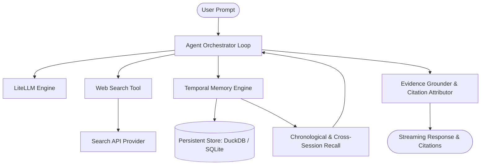

# Minimi

Minimi is a lightweight, high-performance conversational agent featuring grounded web search, timestamped conversation persistence, chronological memory retrieval, and cross-session question recall.

Designed as an independent, streamlined evolution inspired by research-grade search agents, Minimi strips away unnecessary UI/service overhead to focus on core agentic capabilities: fast search orchestration, robust temporal indexing, cross-session recall, and reliable evidence grounding with strict source attribution.

---

## Key Highlights

- **Core Conversational Agent**: Minimalist, robust agent loop supporting pluggable LLM backends via LiteLLM.
- **Consolidated Web Search**: Unified search tool integrating Tavily with structured source attribution, rich snippets, and citation anchors.
- **Timestamped Message Persistence**: Sub-second ISO-8601 timestamp tracking for every turn and tool invocation.
- **Chronological Memory Retrieval**: Query past dialogue turns using explicit temporal windows and relative time phrases (e.g., "earlier today", "yesterday", "last week").
- **Cross-Session Historical Question Recall**: Semantic and temporal recall mechanism allowing the agent to reference historical interactions across distinct sessions.
- **Evidence-Grounded Response Generation**: Strict grounding guardrails and automated citation verification to prevent hallucinated claims.
- **Streamlined Streaming & Orchestration**: Low-latency token streaming and responsive agent iteration.
- **Comprehensive Verification Suite**: Unit, temporal memory evaluation, and security regression test harnesses.

---

## Planning Documents

The project architecture and execution roadmaps are documented across three core planning specifications:

1. [`plan.md`](./plan.md) — Implementation strategy, technical stack decisions, gap analysis, and phased development lifecycle.
2. [`milestones.md`](./milestones.md) — Step-by-step development milestones with verification criteria, deliverables, and commit governance.
3. [`design.md`](./design.md) — System architecture, component models, data schemas, memory mechanics, and security controls.

---

## Architecture Overview



---

## Quick Start (Planned)

### Prerequisites

- Python 3.11+
- `uv` package manager

### Environment Configuration

Create a `.env` file in the project root:

```env
TVLY_API_KEY=your_tavily_api_key
OPENAI_API_KEY=your_openai_api_key
# or GEMINI_API_KEY=your_gemini_api_key
# or ANTHROPIC_API_KEY=your_anthropic_api_key
```

### Development Commands

```bash
# Sync dependencies
uv sync

# Run the test suite
uv run pytest tests/ -v

# Start the Minimi CLI
uv run python -m minimi.cli
```

---

## License

MIT License. See `LICENSE` for details.
