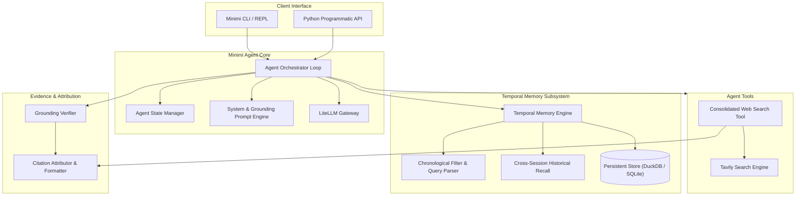

# System Design: Minimi Conversational Agent

## 1. Executive Summary & Design Principles

**Minimi** is a lightweight, evidence-grounded conversational agent with native temporal memory and cross-session question recall. Unlike bloated multi-tool systems with excessive UI dependencies, Minimi focuses on core conversational intelligence, low-latency search orchestration, reliable source attribution, and temporal recall across multi-turn and multi-session interactions.

### Core Architectural Principles
1. **Lightweight & Modular Footprint**: Avoid monolithic dependencies; isolate agent execution, memory persistence, and search tooling into decoupled modules.
2. **Temporal Awareness by Design**: Every message, tool call, and retrieved evidence snippet is strictly timestamped in UTC (ISO-8601).
3. **Cross-Session Recall**: History is not confined to a single session; the agent can index, retrieve, and contextualize questions asked across past sessions.
4. **Verifiable Evidence Grounding**: Responses must cite retrieved sources with precise attribution (Title, URL, snippet citation index). Hallucinations are mitigated via strict prompt grounding.
5. **Deterministic Testing**: All components (LLM calls, search queries, database queries) support deterministic mocking for regression testing.

---

## 2. Architecture & Component Decomposition



### 2.1 Agent Orchestrator (`minimi.agent`)
- Implements a deterministic ReAct / function-calling conversation loop.
- Manages turn execution, tool invocation decisions, iteration bounds (maximum steps per turn to prevent infinite loops), and graceful degradation upon external API failures.
- Handles token streaming yielding tokens, tool lifecycle events, and final citations.

### 2.2 LLM Gateway (`minimi.llm`)
- Standardized wrapper using `LiteLLM` providing uniform completion and streaming across providers (Gemini, OpenAI, Anthropic, Groq, local Ollama).
- Handles parameter normalization (temperature, max_tokens, stop sequences), fallback model routing, and token counting.

### 2.3 Consolidated Web Search Tool (`minimi.search`)
- A single, powerful web search tool consolidating search querying, domain filtering, and result formatting.
- Executes search via Tavily API with structured result parsing:
  - Extract URLs, page titles, and relevant content snippets.
  - De-duplicate search results across queries.
  - Normalize snippets into indexed citation bundles (`[^1]`, `[^2]`).

### 2.4 Evidence Grounding & Citation Engine (`minimi.grounding`)
- Formats evidence blocks injected into LLM context.
- Strict system prompt instructs the agent to cite inline source tags corresponding to retrieved snippets.
- Validates that citations in model output map back to actual retrieved documents.

### 2.5 Temporal Memory & Cross-Session Recall Subsystem (`minimi.memory`)
- **Persistence Store**: Backed by DuckDB (or SQLite), storing conversations, individual messages, and tool invocations with microsecond-precision UTC timestamps.
- **Chronological Retrieval**:
  - Filter messages within specific absolute time windows (`start_time`, `end_time`).
  - Resolve relative temporal queries (e.g., "what did I ask yesterday?", "messages from last week") into concrete datetime ranges.
- **Cross-Session Question Recall**:
  - Indexes all past user questions and assistant answers across session boundaries.
  - Employs hybrid keyword/recency ranking to locate and pull relevant prior queries from past sessions into current conversation context without prompt bloat.

---

## 3. Data Models & Database Schema

### 3.1 Data Structures (Python)

```python
from dataclasses import dataclass, field
from datetime import datetime
from typing import Any, List, Optional


@dataclass
class Citation:
  index: int
  title: str
  url: str
  snippet: str


@dataclass
class SearchResult:
  query: str
  citations: List[Citation]
  raw_results: List[dict]


@dataclass
class Message:
  id: str
  conversation_id: str
  role: str  # 'user', 'assistant', 'system', 'tool'
  content: str
  timestamp: datetime
  tool_calls: Optional[List[dict]] = None
  citations: Optional[List[Citation]] = None
  metadata: dict[str, Any] = field(default_factory=dict)


@dataclass
class Conversation:
  id: str
  title: str
  created_at: datetime
  updated_at: datetime
  metadata: dict[str, Any] = field(default_factory=dict)
```

### 3.2 Relational Database Schema (SQL)

```sql
CREATE TABLE IF NOT EXISTS conversations (
    id VARCHAR PRIMARY KEY,
    title VARCHAR NOT NULL,
    created_at TIMESTAMP WITH TIME ZONE NOT NULL,
    updated_at TIMESTAMP WITH TIME ZONE NOT NULL,
    metadata JSON
);

CREATE TABLE IF NOT EXISTS messages (
    id VARCHAR PRIMARY KEY,
    conversation_id VARCHAR NOT NULL REFERENCES conversations(id),
    role VARCHAR NOT NULL,
    content TEXT NOT NULL,
    timestamp TIMESTAMP WITH TIME ZONE NOT NULL,
    tool_calls JSON,
    citations JSON,
    metadata JSON
);

CREATE INDEX IF NOT EXISTS idx_messages_conversation_id ON messages(conversation_id);
CREATE INDEX IF NOT EXISTS idx_messages_timestamp ON messages(timestamp);
CREATE INDEX IF NOT EXISTS idx_messages_role ON messages(role);

CREATE TABLE IF NOT EXISTS tool_logs (
    id VARCHAR PRIMARY KEY,
    message_id VARCHAR REFERENCES messages(id),
    tool_name VARCHAR NOT NULL,
    input_payload JSON NOT NULL,
    output_payload JSON NOT NULL,
    status VARCHAR NOT NULL,
    execution_time_ms INTEGER NOT NULL,
    created_at TIMESTAMP WITH TIME ZONE NOT NULL
);
```

---

## 4. Temporal Query & Cross-Session Recall Mechanics

### 4.1 Chronological Query Resolution
When a user asks temporal questions (e.g. "What did we discuss earlier today?"):
1. The **Temporal Parser** extracts temporal expressions and anchors them against `datetime.now(timezone.utc)`.
2. A SQL time-bounded query extracts user queries and assistant summaries:
   ```sql
   SELECT role, content, timestamp 
   FROM messages 
   WHERE timestamp BETWEEN :start_ts AND :end_ts
   ORDER BY timestamp ASC;
   ```
3. The retrieved slice is injected into the context window as chronological grounding.

### 4.2 Cross-Session Recall
When a user references historical work without a specific session ID (e.g. "What was that paper we discussed last Tuesday?"):
1. The system scans all historical conversations using full-text and BM25/keyword scoring.
2. Results are filtered by session timestamps.
3. Relevant conversational snippets are summarized and provided to the agent as an explicit historical grounding context block:
   ```text
   <historical_context session_id="..." timestamp="...">
   User: ...
   Assistant: ...
   </historical_context>
   ```

---

## 5. Security, Resilience & Quality Attributes

1. **Secret Isolation**: All credentials (`TVLY_API_KEY`, LLM provider keys) are resolved strictly via environment variables or `.env` files. No credentials will ever be persisted or logged.
2. **Loop & Resource Guardrails**: Hard limit on agentic tool iterations (default: 5 iterations per turn) and maximum retrieval context tokens to prevent runaway costs.
3. **Graceful Tool Degradation**: If Tavily or network calls fail, the agent informs the user clearly and responds with known information rather than crashing.
4. **Deterministic Testing**: Mock fixtures for Tavily API and LiteLLM completions ensure that memory, search, and agent orchestration tests run offline and reliably.
